# AWS EKS AI Chatbot — DevOps Platform

An AWS EKS-based DevOps platform demonstrating **CI-driven infrastructure lifecycle management**. The project provisions and tears down the EKS platform, ECR, platform add-ons, observability components, and an Amazon Bedrock-powered chatbot using reproducible workflows.

---

## 🏗️ System Architecture

### Service Architecture

User traffic passes through Cloudflare's proxy layer before reaching an AWS Application Load Balancer (ALB). The ALB routes requests to the chatbot workload inside EKS, where the backend invokes Amazon Bedrock for AI inference.

---

## 🚀 Lifecycle Management

**GitHub Actions** is the standard entry point for infrastructure lifecycle operations.

### 0. Prerequisites

Before running the workflows, configure the following in your AWS account:

1. Create a **GitHub OIDC identity provider**.
2. Create an **IAM role** that GitHub Actions can assume using `AssumeRoleWithWebIdentity`.
3. Grant the role the permissions required to:
   - Provision the AWS resources defined in Pulumi.
   - Manage the EKS cluster.

> **Security note:** Scope the role's trust policy and permissions to the workflows and resources that require access.

### Workflow Overview

The core design principle is **CI-driven infrastructure**: provision, deployment, and teardown operations are normally initiated through GitHub Actions.

### 1. Provision the Environment

Provision the VPC, EKS cluster, managed node groups, and foundational add-ons:

1. Open the repository's **Actions** tab.
2. Select **Platform Lifecycle Management**.
3. Click **Run workflow**.
4. Choose `up` and run the workflow.

### 2. Access and Verify the Cluster

After provisioning, configure local access:

1. Update your kubeconfig:

   ```bash
   aws eks update-kubeconfig --name eks-dev --region ap-northeast-1
   ```

2. **Configure permissions:** Create an EKS Access Entry and associate an appropriate access policy. This can be done through Pulumi or the AWS CLI. Administrative access should be limited to authorized operators.

### 3. Deploy Applications via GitOps

1. **Upload static assets:** Run the workflow with `artifact` to upload assets to S3/CloudFront and build application artifacts.
2. **Initiate application deployment:** Run the workflow with `deploy` to execute the application deployment tasks and trigger ArgoCD synchronization.
3. **Continuous delivery:** When application code changes, CI builds the Docker image, pushes it to ECR, and updates the GitOps image reference. ArgoCD reconciles the desired state with the cluster.

### 4. Destroy the Environment

**⚠️ Warning: This operation deletes provisioned infrastructure and application resources. Review the target environment before proceeding.**

1. Open the repository's **Actions** tab.
2. Select **Platform Lifecycle Management**.
3. Click **Run workflow**, choose `destroy`, and execute it.

> If teardown is delayed or blocked by resources such as ALB/Ingress finalizers, see [the troubleshooting and recovery runbook](docs/troubleshooting.md).

---

## 📂 Project Structure

- `ansible/` — **Workflow orchestration:** Connects bootstrap, platform provisioning, static asset upload, application deployment, and teardown.
- `app/` — **Application source:** Contains the chatbot's Dockerfile, static assets, and Streamlit application.
- `infra/` — **Infrastructure as Code:** Uses Pulumi (Python) to provision AWS resources and EKS add-ons.
- `k8s/` — **Kubernetes manifests:** Contains Kustomize overlays and application deployment definitions.
- `scripts/` — **Helper utilities:** Includes scripts for building and packaging the chatbot.

---

## Chatbot Service Architecture

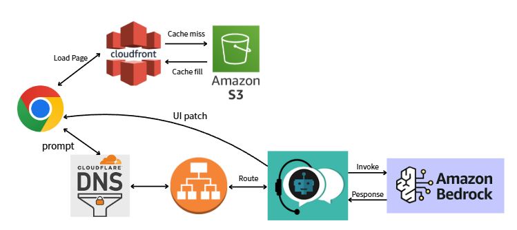

**Demo URL:** https://dev.hrscyj.uk

**Request flow:** Browser → Cloudflare DNS/Proxy → AWS ALB (Ingress) → EKS Service → Chatbot Pod → Amazon Bedrock

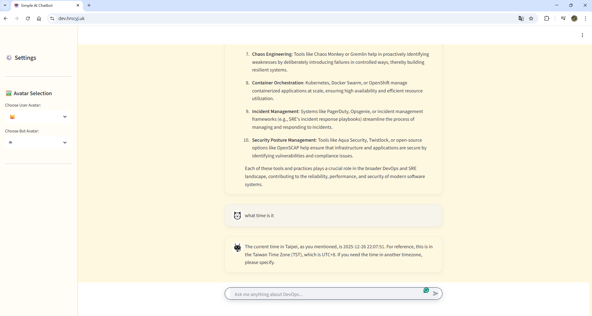
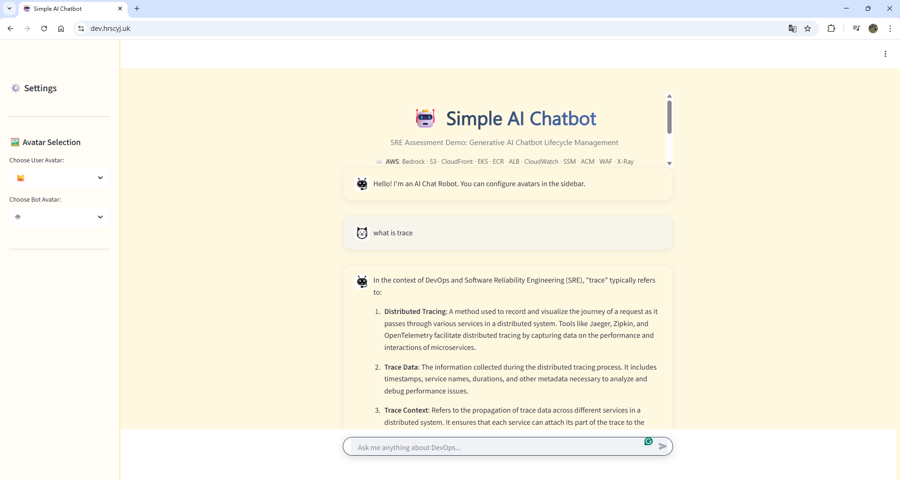
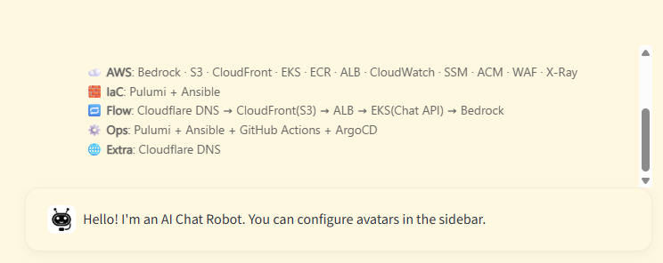

## 🛠️ Technology Stack

### 1. Infrastructure Layer

| Component | Responsibility |
| :--- | :--- |
| **Amazon EKS** | Managed Kubernetes control plane and orchestration for application workloads |
| **Amazon ECR** | Container image registry for the chatbot |
| **Amazon VPC** | Network isolation and connectivity for cloud resources |
| **AWS ALB** | Layer 7 traffic routing through the AWS Load Balancer Controller |
| **Amazon CloudFront** | CDN for static assets, with edge security integration |
| **AWS IAM** | Access control with OIDC, IRSA, and workload identities |
| **Amazon S3** | Storage for static website assets |
| **Amazon Bedrock** | Managed foundation-model inference (e.g., Claude/Titan) |
| **AWS Systems Manager** | Parameter Store for configuration and secret values |

### 2. Platform Layer

| Category | Component | Responsibility |
| :--- | :--- | :--- |
| **GitOps** | **ArgoCD** | Automated synchronization, drift detection, and app-of-apps deployment |
| **Secret Management** | **External Secrets Operator (ESO)** | Synchronizes secrets from AWS Systems Manager Parameter Store into Kubernetes |
| **Ingress** | **AWS Load Balancer Controller** | Integrates Kubernetes Ingress with ALB for Layer 7 routing and TLS termination |
| **Security** | **cert-manager** | Manages certificates used by in-cluster components and webhooks |
| **Observability** | **ADOT Collector** | Collects logs, metrics, and traces for AWS CloudWatch and X-Ray |
| **Workload Identity** | **EKS Pod Identity** | Provides AWS authentication for workloads invoking Amazon Bedrock |
| **Application** | **AI Chatbot** | Wraps Amazon Bedrock model interaction in a Streamlit-based conversational UI |

---

## CI/CD and GitOps

This project combines **push-based continuous integration** with **pull-based GitOps deployment** using GitHub Actions and ArgoCD.

**Continuous Integration — GitHub Actions**

When application code is pushed to the `main` branch, GitHub Actions builds and pushes a container image to Amazon ECR and updates the GitOps manifest with the new image tag.

**Continuous Delivery — ArgoCD**

Once CI updates the manifests in Git, ArgoCD detects the desired-state change and reconciles the Kubernetes workloads.

---

## 📊 Observability

The project uses **AWS Distro for OpenTelemetry (ADOT)** as a telemetry collection and export layer.

### Logs

Application telemetry is collected via OTLP and exported to **Amazon CloudWatch Logs**.

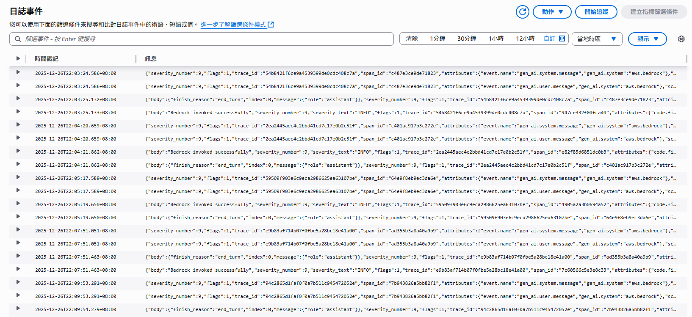

### Distributed Tracing

**Trace IDs** and **spans** help reconstruct request paths. The **AWS X-Ray Service Map** can be used to investigate bottlenecks and trace slow chatbot responses.

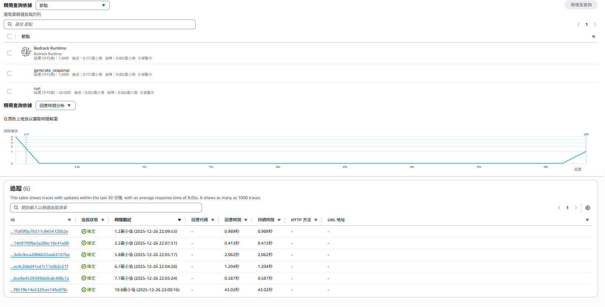

For example, when users report slow chatbot responses, X-Ray can help identify where request latency originates.

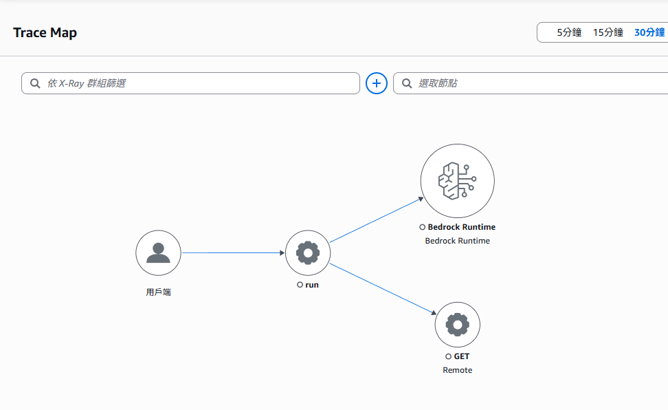

### Metrics

The ADOT Collector gathers and exports system-level telemetry.

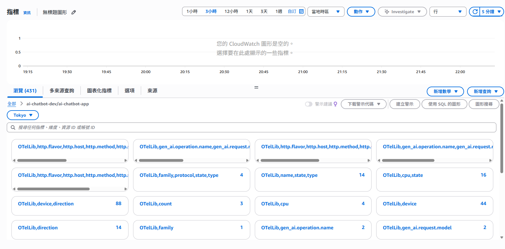

### Service-Level Indicators and Objectives (SLIs/SLOs)

Key service-level indicators include **request success rate**, **p95 latency**, and **fallback rate**. CloudWatch alarms are configured to detect abnormal behavior based on these measurements.

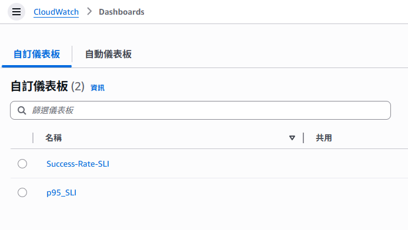

### Alerting

Custom latency and fallback-rate indicators are used to configure operational alarms.

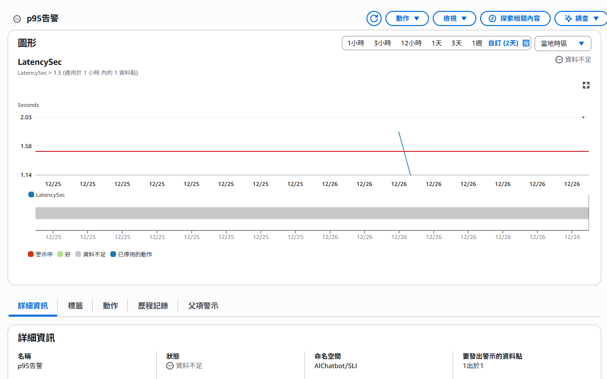
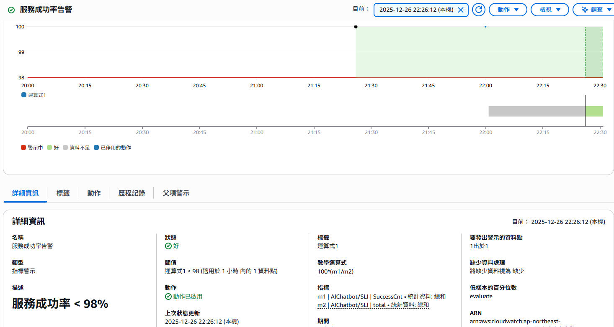

---

## 💡 Architecture Highlights

### 🔐 Keyless Authentication and Secret Management

- **CI identity:** GitHub OIDC enables workflows to assume AWS roles without storing long-lived AWS access keys.
- **Runtime identity:** IRSA and EKS Pod Identity enable workload-level AWS authentication and support least-privilege permission design.
- **Secrets:** ESO integrates with SSM Parameter Store, avoiding the need to commit application secrets to Git.

### ⚙️ Platform Engineering and Repeatability

- **Pulumi** defines cloud infrastructure as code.
- **Ansible** orchestrates the multi-step lifecycle of infrastructure, platform add-ons, and application deployment.
- **GitHub Actions** exposes repeatable provisioning and teardown operations.

### 🛡️ Pull-Based GitOps Delivery

- **ArgoCD** reconciles application state from Git, separating application delivery from direct CI-driven Kubernetes mutation.
- CI can publish artifacts and update declarative manifests without requiring direct administrative access to the Kubernetes API.

---
